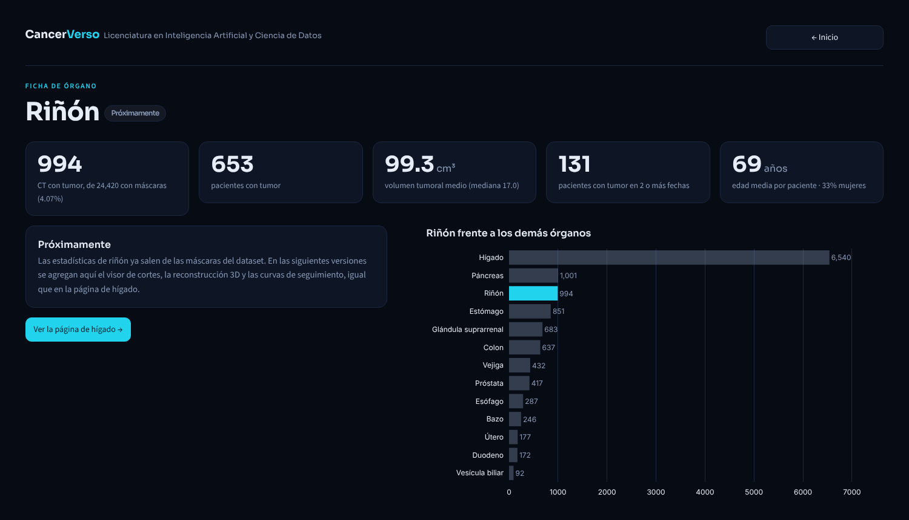

# CancerVerso

**Explorador multiórgano de tumores en tomografía computarizada.**
Proyecto de Big Data (proceso KDD) · Licenciatura en Inteligencia Artificial y Ciencia de Datos · CUGDL, Universidad de Guadalajara.

> Prototipo académico. No es un dispositivo médico ni sustituye el diagnóstico de un especialista.

**Integrantes:** Isay Morales, Christopher Medrano, Paul Rondan y Astrin Paloma.
**Materia y profesor:** Manejo de grandes volumenes de datos · Profesor Leonardo Zucco.

---

## 1. Qué es

CancerVerso es un dashboard en Streamlit que permite:

- Ver las cifras generales del dataset CancerVerse y elegir un órgano en un **menú de 13 órganos**.
- Para **hígado** (el órgano activo en esta versión): recorrer la tomografía corte por corte con el tumor marcado, ver el hígado y los tumores en **3D**, y medir la **carga tumoral hepática (HTB%)**.
- Seguir a un mismo paciente **en el tiempo**: cómo cambia el volumen de su tumor entre estudios.

Los otros 12 órganos ya muestran sus estadísticas y están marcados como "Próximamente".

## 2. Capturas

| Portada | Mapa de órganos |
|---|---|
|  |  |

| Visor de cortes y 3D | HTB% |
|---|---|
|  |  |

| Seguimiento del paciente | Ficha de otro órgano |
|---|---|
|  |  |

## 3. Dataset

[BodyMaps/CancerVerse](https://huggingface.co/datasets/BodyMaps/CancerVerse) (Johns Hopkins University). Licencia CC BY-NC-ND 4.0.

| Dato | Valor |
|---|---|
| Tamaño total | 3.04 TB |
| Tomografías (CT) | 24,422 (24,420 con máscaras) |
| Pacientes | 14,599 |
| Órganos con tumores anotados | 13 |
| Anotaciones de tumor (CT × órgano) | 12,529 |
| Anotaciones de tumor en hígado | 6,540 |

El dataset trae la máscara del **tumor** de cada órgano, pero no la máscara del órgano. Por eso el hígado se segmenta aparte (ver sección 4).

**Este repositorio no incluye datos.** Por la licencia del dataset y porque las tablas traen reportes radiológicos, aquí solo está el código. Los datos se generan corriendo el notebook.

## 4. Cómo funciona

```
Hugging Face (CTs)  ─┐
                     ├─► Notebook de Colab ─► Google Drive (stats + procesados) ─► app.py (Streamlit)
Máscaras de tumor  ──┘
```

1. **Medición de máscaras.** El notebook recorre las máscaras de tumor de los 13 órganos y calcula el volumen de cada tumor en cm³, sin bajar ningún CT.
2. **Segmentación del hígado (deep learning).** Para cada CT de hígado elegido se corre **TotalSegmentator 2.18.0**, una red neuronal preentrenada, que devuelve la máscara del hígado.
3. **Carga tumoral hepática.**
   `HTB% = volumen de tumor ÷ volumen de (hígado ∪ tumor) × 100`
   Se usa la unión porque TotalSegmentator a veces deja fuera del hígado los tumores grandes.
4. **Control de calidad.** Se revisa que CT y máscaras estén alineados y se generan imágenes de los casos donde más del 10% del tumor quedó fuera de la máscara de hígado.
5. **Seguimiento.** Para pacientes con 2 o más fechas se arma la curva de volumen tumoral, prefiriendo la misma fase del estudio en todas las fechas. Si en una fecha no existe esa fase se usa la disponible y el paciente queda marcado en la columna `misma_fase` (en la parte 0, 253 de 441 pacientes conservan una sola fase). Los pacientes elegidos para la demostración sí mantienen una sola fase.
6. **Dashboard.** La app solo lee las tablas y los volúmenes reducidos que dejó el notebook.

El trabajo se reparte por paciente en 3 partes (una por cuenta de Colab) y al final se junta.

Umbrales usados, marcados como **provisionales**:

- Semáforo de HTB% en 25% y 50%: criterio del equipo, todavía sin fuente clínica.
- Tendencia del volumen (+73% crece, −66% se reduce): equivalente en volumen de RECIST 1.1 (Eisenhauer et al., *Eur J Cancer*, 2009), que define +20% y −30% de diámetro.

## 5. Avance al 19 de noviembre de 2026

| Etapa | Estado |
|---|---|
| Medición de máscaras, parte 0 de 3 (8,273 CTs, 4,120 anotaciones de tumor) | Hecho |
| Hígado a detalle, parte 0: 1,909 CTs de 912 pacientes (245 GB de CT) | Hecho |
| Dashboard V1 (portada, menú de órganos, hígado, seguimiento) | Hecho |
| Partes 1 y 2 (unos 385 CTs más, ya corridos por el equipo) | Falta juntarlas |
| Modelo propio: U-Net 2D de segmentación de tumor hepático (MONAI) | Pendiente |
| Meta de datos procesados: 300 GB (deseable 1 TB) | 245 GB con la parte 0 |

Las cifras del dashboard son de la parte 0 (un tercio de los pacientes), no del dataset completo. El visor de cortes y 3D solo muestra los CTs cuyo `volumen.npz` se copió a `datos/procesados/higado`.

El detalle por etapa del proceso KDD está en [docs/KDD.md](docs/KDD.md).

## 6. Cómo correrlo

**Preparar los datos (Google Colab, GPU T4):**

1. Abrir `notebooks/CancerVerso_V1.ipynb` en Colab.
2. Entorno de ejecución → Ejecutar todo. Los resultados quedan en `MyDrive/Big data Zucco/`.
3. Si Colab se desconecta, volver a ejecutar todo: lo ya hecho se salta.

**Levantar la app (local):**

```bash
pip install -r requirements.txt
streamlit run app.py
```

La app busca los datos en una carpeta `datos/` junto a `app.py`:

```
datos/stats/                 stats_organos.csv, resumen_dataset.json, casos_higado.csv,
                             seguimiento_higado.csv, checklist_higado.csv
datos/procesados/higado/     una carpeta por CT, con su volumen.npz
```

Si solo se corrió una parte, los archivos de `stats/` salen con sufijo (`_parte0`); hay que copiarlos sin el sufijo. Con todas las partes, la sección 13 del notebook genera los archivos finales en `stats_union/`.

## 7. Estructura del repositorio

```
app.py                         dashboard de Streamlit
estilo.css                     estilos del dashboard
requirements.txt               librerías de la app
.streamlit/config.toml         tema oscuro de la app
notebooks/CancerVerso_V1.ipynb preparación de datos (Colab)
docs/KDD.md                    proceso KDD del proyecto
capturas/                      imágenes del dashboard
```

## 8. Qué sigue y qué necesitamos

**Siguiente versión**

- Entrenar una U-Net 2D propia para segmentar tumor hepático y comparar su resultado con la anotación de los expertos (Dice).
- Conectar el modelo a la app para que muestre la predicción junto a la anotación.
- Activar más órganos en el menú.

**Apoyo que nos ayudaría**

- **Cómputo:** hoy usamos una GPU T4 de Colab. Para entrenar la U-Net y llegar a 300 GB procesados necesitamos más horas de GPU.
- **Almacenamiento:** espacio compartido para guardar los CTs procesados de todo el equipo.
- **Asesoría técnica:** uso de MONAI para el entrenamiento, y si conviene LoRA o ajuste fino sobre un modelo preentrenado en lugar de entrenar desde cero.
- **Criterio clínico:** una fuente para los cortes del semáforo de HTB%.

## 9. Créditos

- Datos: CancerVerse, BodyMaps, Johns Hopkins University. CC BY-NC-ND 4.0.
- Segmentación de hígado: TotalSegmentator 2.18.0 (Wasserthal et al.).
- RECIST 1.1: Eisenhauer et al., *European Journal of Cancer*, 2009.
