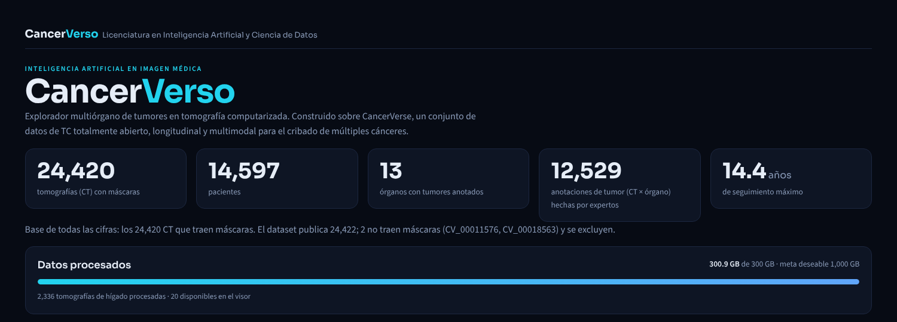
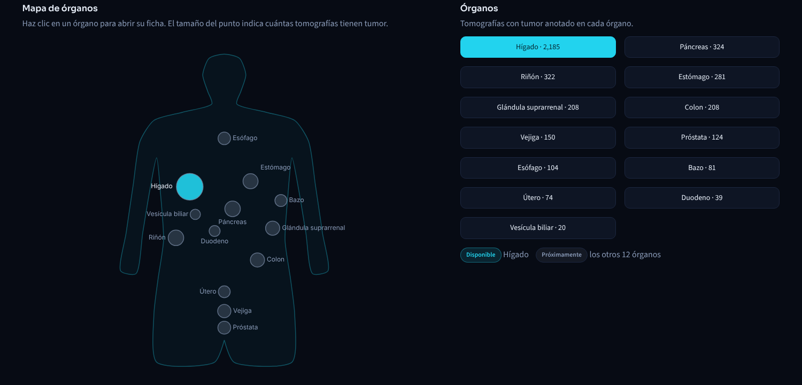
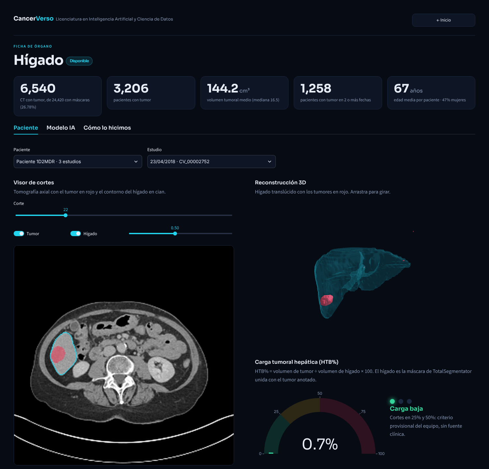
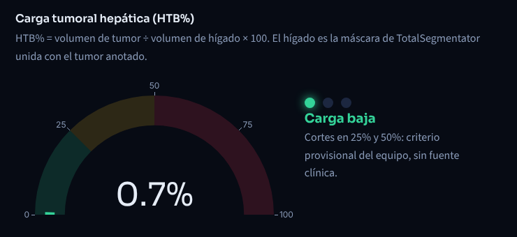
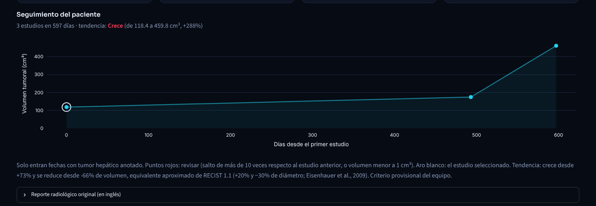
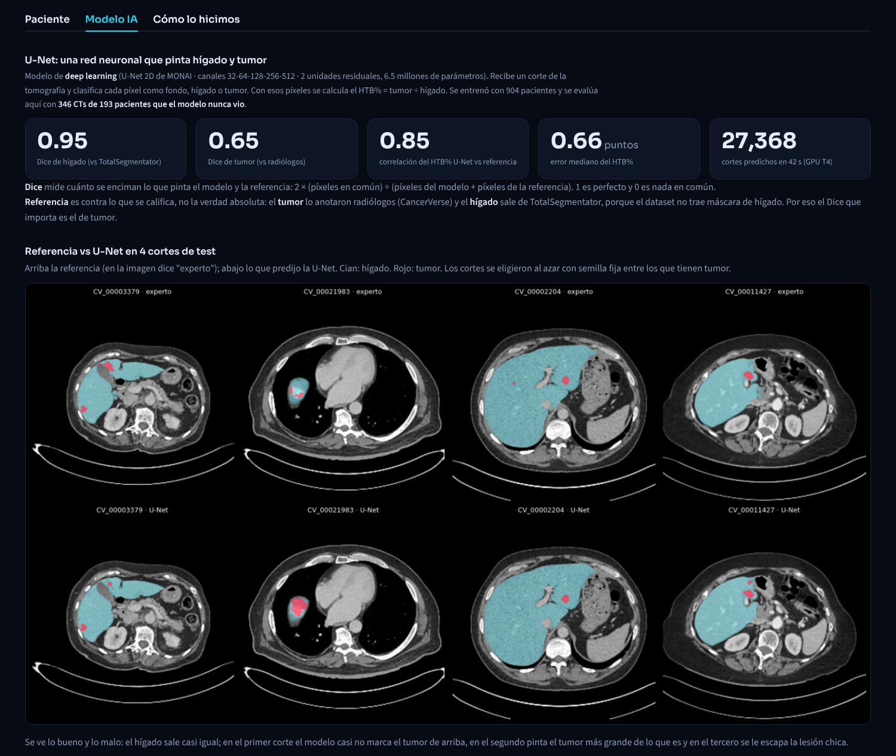
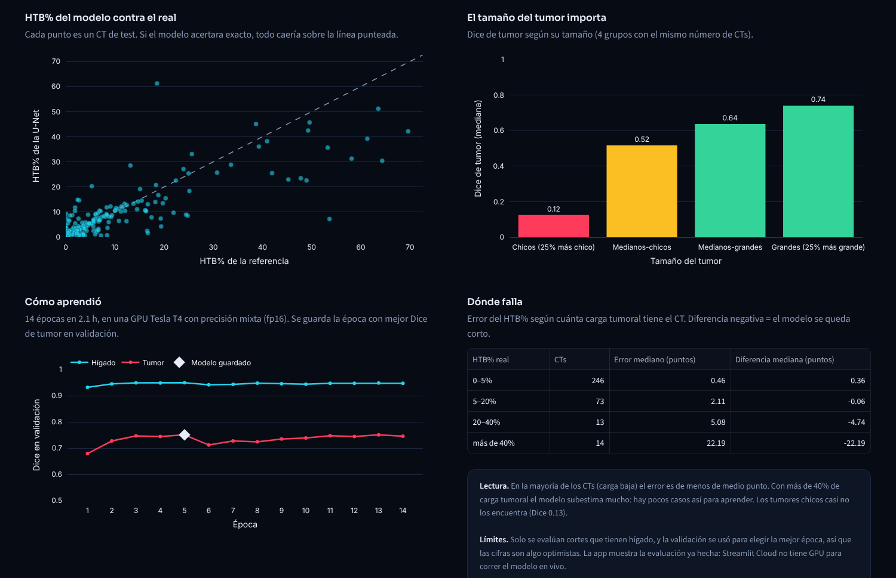
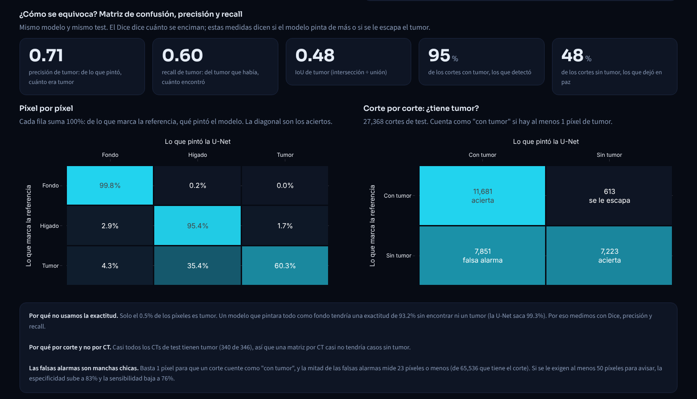
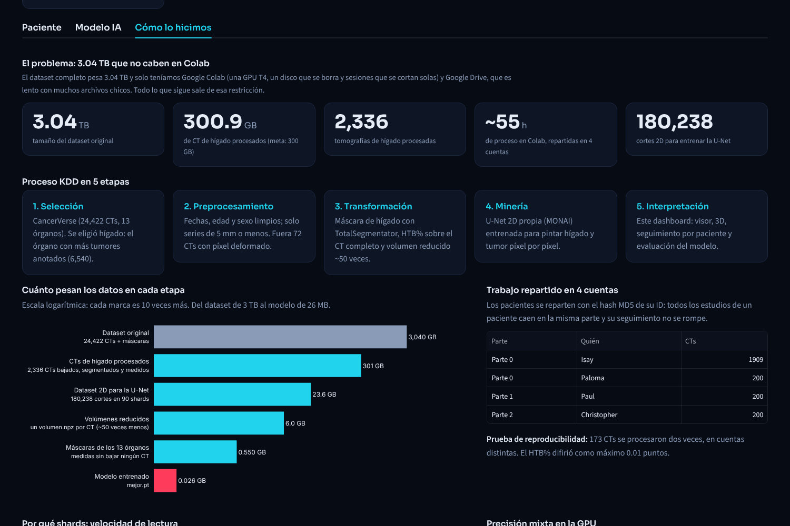
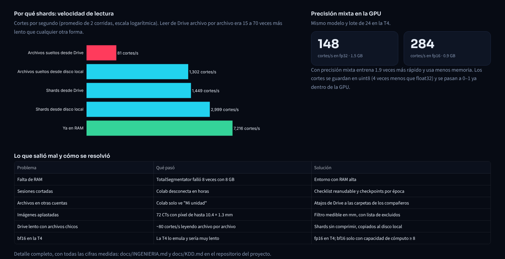

# CancerVerso

**Explorador multiórgano de tumores en tomografía computarizada.**
Proyecto de Big Data (proceso KDD) · Licenciatura en Inteligencia Artificial y Ciencia de Datos · CUGDL, Universidad de Guadalajara.

> Prototipo académico. No es un dispositivo médico ni sustituye el diagnóstico de un especialista.

**Integrantes:** Isay Morales, Christopher Medrano, Paul Rondan y Astrin Paloma.
**Materia y profesor:** Manejo de grandes volúmenes de datos · Profesor Leonardo Zucco.
**Versión final:** 25 de noviembre de 2026.

---

## En números

| | |
|---|---|
| Dataset de origen | **3.04 TB** · 24,422 tomografías (CT) · 14,599 pacientes · 13 órganos |
| CT de hígado procesados a detalle | **300.9 GB** · 2,336 CTs de 1,319 pacientes (meta mínima: 300 GB) |
| Tiempo de proceso | ~55 h en Google Colab, repartidas en 4 cuentas |
| Dataset para el modelo | 180,238 cortes 2D en 90 shards (23.6 GB), separados por paciente |
| Modelo | U-Net 2D (deep learning, MONAI) entrenada por el equipo en una GPU T4 |
| Resultado en pacientes nunca vistos | Dice de tumor **0.65** (precisión 0.71 · recall 0.60) · Dice de hígado **0.95** · HTB% con correlación **0.85** |

---

## 1. Qué es

**Pregunta del proyecto:** ¿cuánto del hígado de un paciente está ocupado por tumor, y cómo cambia eso entre un estudio y el siguiente?

CancerVerso es un dashboard en Streamlit que permite:

- Ver las cifras generales del dataset CancerVerse y elegir un órgano en un **menú de 13 órganos**.
- En **hígado**, el órgano con página completa, hay tres pestañas:
  - **Paciente:** recorrer la tomografía corte por corte con el tumor marcado, ver el hígado y los tumores en **3D**, medir la **carga tumoral hepática (HTB%)** y seguir al paciente **en el tiempo**.
  - **Modelo IA:** la U-Net que entrenamos, con sus métricas en pacientes que nunca vio, cortes de ejemplo referencia vs U-Net, matrices de confusión, precisión y recall, y dónde falla.
  - **Cómo lo hicimos:** el proceso KDD, cuánto pesan los datos en cada etapa, el reparto del trabajo, los benchmarks y los problemas que resolvimos.
- Los otros 12 órganos muestran sus estadísticas, calculadas sobre el dataset completo.

La versión web está en `cancerverso-udg.streamlit.app` y es privada: se entra con el enlace con clave que comparte el equipo.

## 2. Recorrido por la app

**Portada:** cifras del dataset y avance de datos procesados.



**Mapa de órganos:** clic en un órgano para abrir su ficha.



**Hígado › Paciente:** visor de cortes (tumor en rojo, contorno del hígado en cian) y reconstrucción 3D.



| Carga tumoral hepática (HTB%) | Ficha de un órgano sin página completa |
|---|---|
|  |  |

**Hígado › Paciente:** seguimiento del volumen tumoral en el tiempo.



**Hígado › Modelo IA:** métricas de la U-Net y 4 cortes de prueba, referencia arriba y U-Net abajo.



**Hígado › Modelo IA:** HTB% del modelo contra el real, Dice por tamaño de tumor, curva de entrenamiento y dónde falla.



**Hígado › Modelo IA:** matriz de confusión por píxel y por corte, precisión, recall e IoU.



**Hígado › Cómo lo hicimos:** el problema, las 5 etapas del KDD, tamaño de los datos por etapa y reparto del trabajo.



**Hígado › Cómo lo hicimos:** benchmark de lectura, precisión mixta y problemas resueltos.



## 3. Dataset

[BodyMaps/CancerVerse](https://huggingface.co/datasets/BodyMaps/CancerVerse) (Johns Hopkins University). Licencia CC BY-NC-ND 4.0.

| Dato | Valor |
|---|---|
| Tamaño total | 3.04 TB |
| Tomografías (CT) | 24,422 (24,420 con máscaras) |
| Pacientes | 14,599 |
| Órganos con tumores anotados | 13 |
| Anotaciones de tumor (CT × órgano) | 12,529 |
| Anotaciones de tumor en hígado | 6,540 |

El dataset trae la máscara del **tumor** de cada órgano, pero no la máscara del órgano. Por eso el hígado se segmenta aparte (ver sección 4).

**Este repositorio no incluye datos de pacientes.** Por la licencia del dataset y porque las tablas traen reportes radiológicos, aquí está el código y solo cifras agregadas del modelo (`resultados/`). Los datos se generan corriendo los notebooks.

## 4. Cómo funciona

```
Hugging Face (3.04 TB) ─► V1: medir, segmentar hígado, HTB%, reducir ─► V2: dataset 2D en shards ─► V3: U-Net ─► app.py (Streamlit)
                          (2,336 CTs · 300.9 GB leídos)                 (180,238 cortes · 23.6 GB)   (T4, 14 épocas)
```

**Notebook V1 (datos):**

1. **Medición de máscaras.** Recorre las máscaras de tumor de los 13 órganos y calcula el volumen de cada tumor en cm³, sin bajar ningún CT (0.55 GB leídos).
2. **Segmentación del hígado.** Para cada CT de hígado elegido corre **TotalSegmentator 2.18.0**, una red neuronal preentrenada, que devuelve la máscara del hígado.
3. **Carga tumoral hepática.**
   `HTB% = volumen de tumor ÷ volumen de (hígado ∪ tumor) × 100`
   Se usa la unión porque TotalSegmentator a veces deja fuera del hígado los tumores grandes.
4. **Control de calidad.** Revisa que CT y máscaras estén alineados y genera imágenes de los casos donde más del 10% del tumor quedó fuera de la máscara de hígado.
5. **Seguimiento.** Para pacientes con 2 o más fechas arma la curva de volumen tumoral, prefiriendo la misma fase del estudio en todas las fechas. Si en una fecha no existe esa fase usa la disponible y el paciente queda marcado en la columna `misma_fase` (con las 3 partes unidas, 688 de 1,258 pacientes conservan una sola fase). Los pacientes de la demostración mantienen una sola fase.
6. **Volumen reducido.** Guarda cada CT ~50 veces más chico para la app y el modelo; las métricas se calculan antes, sobre el CT completo.

El trabajo se repartió por paciente en 3 partes (hash MD5 del ID) entre 4 cuentas de Colab y al final se unió. 173 CTs se procesaron dos veces como prueba de reproducibilidad: el HTB% difirió como máximo 0.01 puntos.

**Notebook V2 (dataset para el modelo):** inventario de los 2,336 volúmenes, validación, exclusión de 72 CTs con píxel deformado, separación **por paciente** (70/15/15, semilla 42) y 90 shards sin comprimir con huella MD5 en un manifiesto.

**Notebook V3 (modelo):** U-Net 2D de MONAI (6.5 millones de parámetros) que clasifica cada píxel como fondo, hígado o tumor. Pérdida Dice + entropía cruzada, AdamW, precisión mixta fp16 en una T4. Se guarda la época con mejor Dice de tumor en validación y se evalúa en 346 CTs de 193 pacientes que el modelo nunca vio.

**Notebook V3b (más métricas):** no entrena. Carga el mismo modelo y el mismo test y calcula la matriz de confusión por píxel (fondo, hígado, tumor), precisión, recall e IoU por clase, la matriz por corte (¿tiene tumor?) con sensibilidad y especificidad, el tamaño de las falsas alarmas y la exactitud de un modelo que pinta todo de fondo. Se corrió en una L4 (no había T4 libre); el Dice salió igual que en la V3 (hígado 0.949, tumor 0.652 contra 0.653).

**Contra qué se califica (referencia):** el tumor, contra las máscaras de CancerVerse anotadas por radiólogos; el hígado, contra TotalSegmentator unido con el tumor, porque el dataset no trae máscara de hígado. La referencia es la mejor respuesta disponible, no la verdad absoluta.

**App:** solo lee lo que dejaron los notebooks. No corre el modelo en vivo: muestra la evaluación ya hecha.

Umbrales usados, marcados como **provisionales**:

- Semáforo de HTB% en 25% y 50%: criterio del equipo, sin fuente clínica.
- Tendencia del volumen (+73% crece, −66% se reduce): equivalente en volumen de RECIST 1.1 (Eisenhauer et al., *Eur J Cancer*, 2009), que define +20% y −30% de diámetro.

## 5. Resultados

**Datos**

| Etapa | Resultado |
|---|---|
| Medición de máscaras (dataset completo) | 24,420 CTs y 12,529 anotaciones de tumor, sin bajar ningún CT |
| Hígado a detalle | 2,336 CTs de 1,319 pacientes · **300.9 GB** de CT · meta mínima de 300 GB cumplida |
| Dataset 2D | 180,238 cortes de 2,264 CTs en 90 shards (23.6 GB), 0 pacientes en dos grupos |
| Lectura | Drive archivo por archivo ~80 cortes/s; con shards o en disco local, más de 1,300 |
| Entrenamiento | fp16 en la T4: 284 cortes/s contra 148 en fp32 (1.9 veces) |

**Modelo (346 CTs de prueba, 193 pacientes nunca vistos)**

| Métrica | Valor |
|---|---|
| Dice de hígado (global / mediana por CT) | 0.949 / 0.969 |
| Dice de tumor (global / mediana por CT) | 0.653 / 0.521 |
| Dice de tumor, tumores chicos / grandes | 0.13 / 0.74 |
| HTB% del modelo vs real: correlación / error mediano | 0.85 / 0.66 puntos |
| Tumor por píxel: precisión / recall / IoU | 0.71 / 0.60 / 0.48 |
| Hígado por píxel: precisión / recall / IoU | 0.94 / 0.95 / 0.90 |
| Por corte, ¿tiene tumor?: sensibilidad / especificidad (1 píxel basta) | 95% / 48% |
| Mismo, exigiendo al menos 50 píxeles | 76% / 83% |
| Exactitud por píxel: U-Net / modelo que pinta todo de fondo | 99.3% / 93.2% |

El hígado coincide casi perfecto con TotalSegmentator. El tumor depende de su tamaño: las lesiones chicas son las difíciles. El modelo se queda corto más de lo que inventa: lo que pinta como tumor casi siempre lo es (precisión 0.71), pero no pinta el 40% del tumor, y el 35% lo pinta como hígado. Por corte casi no deja pasar tumores, pero da falsas alarmas: la mitad mide 23 píxeles o menos de 65,536. La exactitud no se usa porque el tumor es solo el 0.5% de los píxeles. El HTB% sale cerca del real en la mayoría de los CTs, pero el modelo subestima los casos con más de 40% de carga tumoral.

Detalle: proceso KDD en [docs/KDD.md](docs/KDD.md), ingeniería de datos en [docs/INGENIERIA.md](docs/INGENIERIA.md), diccionario y linaje en [docs/DATOS.md](docs/DATOS.md) y guía para presentar en [docs/DEFENSA.md](docs/DEFENSA.md).

## 6. Cómo correrlo

**Preparar los datos (Google Colab, GPU T4):**

1. Abrir `notebooks/CancerVerso_V1.ipynb` en Colab.
2. Entorno de ejecución → Ejecutar todo. Los resultados quedan en `MyDrive/Big data Zucco/`.
3. Si Colab se desconecta, volver a ejecutar todo: lo ya hecho se salta.

**Dataset para el modelo y U-Net (Google Colab):**

1. `notebooks/CancerVerso_V2_datos_modelo.ipynb` (CPU con RAM amplia): inventario, validación, separación por paciente y shards en `MyDrive/Big data Zucco/dataset_modelo/v2/`.
2. `notebooks/CancerVerso_V3_unet.ipynb` (GPU): verifica las huellas MD5, entrena la U-Net y la evalúa. Los resultados quedan en `MyDrive/Big data Zucco/modelos/unet_<gpu>/`. La corrida entregada, con todas sus salidas, es `CancerVerso_V3_unet_corrida_T4.ipynb`.
3. `notebooks/CancerVerso_V3b_metricas.ipynb` (GPU, ~5 min): métricas extra del mismo modelo. Guarda `metricas_extra.json` y `matrices_confusion.png` en `modelos/unet_t4/`; el JSON se copia a `resultados/`. La corrida ejecutada está en Drive como `CancerVerso_V3b_metricas_corrida_L4.ipynb`.

**Levantar la app (local):**

```bash
pip install -r requirements.txt
streamlit run app.py
```

La app busca los datos en una carpeta `datos/` junto a `app.py`:

```
datos/stats/                 stats_organos.csv, resumen_dataset.json, casos_higado.csv,
                             seguimiento_higado.csv, checklist_higado.csv
datos/procesados/higado/     una carpeta por CT, con su volumen.npz
```

Los resultados del modelo sí vienen en el repositorio, en `resultados/` (cifras agregadas, sin IDs de pacientes):

```
resultados/unet_t4.json      métricas de la U-Net en test, bitácora de entrenamiento y HTB% real vs predicho
resultados/ejemplos_test.png 4 cortes de test: referencia vs U-Net (la misma imagen del notebook V3; en la imagen dice "experto")
resultados/metricas_extra.json matrices de confusión, precisión, recall, IoU y falsas alarmas (notebook V3b)
resultados/revision_duplicados.json CTs duplicados entre entrenamiento y prueba, y métricas sin ellos (revisar_duplicados.py)
resultados/proceso.json      cifras del proceso de datos (de docs/INGENIERIA.md)
```

La versión web (`cloud_app.py`) se explica en [docs/DESPLIEGUE.md](docs/DESPLIEGUE.md).

## 7. Estructura del repositorio

```
app.py                         dashboard de Streamlit
estilo.css                     estilos del dashboard
cloud_app.py                   entrada de la versión web (Streamlit Cloud)
resultados/                    resultados de la U-Net y cifras del proceso que muestra la app
requirements.txt               librerías de la app
.streamlit/config.toml         tema oscuro de la app
notebooks/CancerVerso_V1.ipynb preparación de datos (Colab)
notebooks/CancerVerso_V1_ampliacion.ipynb     versión del V1 que se usó en Colab para ampliar los casos de hígado
notebooks/CancerVerso_V2_datos_modelo.ipynb   dataset 2D para el modelo (Colab)
notebooks/CancerVerso_V3_unet.ipynb           U-Net: entrenamiento y evaluación (Colab)
notebooks/CancerVerso_V3_unet_corrida_T4.ipynb  corrida entregada de la U-Net, con resultados
notebooks/CancerVerso_V3b_metricas.ipynb      métricas extra de la U-Net: matrices de confusión, precisión y recall (Colab)
notebooks/revisar_duplicados.py                CTs duplicados entre entrenamiento y prueba, y métricas sin ellos
docs/KDD.md                    proceso KDD del proyecto
docs/DATOS.md                  diccionario de datos y linaje
docs/INGENIERIA.md             cómo se procesaron los datos
docs/DEFENSA.md                guion de demo y preguntas y respuestas
docs/DESPLIEGUE.md             cómo se publica la versión web
capturas/                      imágenes del dashboard
```

## 8. Límites

- Solo hígado tiene página completa; los otros 12 órganos muestran estadísticas.
- Se procesaron a detalle 300.9 GB de los 3.04 TB; las estadísticas por órgano sí cubren el dataset completo.
- El visor de cortes y 3D muestra 20 CTs de demostración, no los 2,336.
- Las cifras del modelo son algo optimistas: la validación se usó para elegir la mejor época y solo se evalúan cortes con hígado.
- La referencia del hígado no es humana (TotalSegmentator): el Dice de hígado mide coincidencia con esa herramienta. La de tumor sí es de radiólogos.
- **CTs duplicados en el dataset:** 291 de los 2,336 CTs tienen un gemelo idéntico (mismo volumen de tumor y de hígado, mismas lesiones y cortes), casi siempre con **otro ID de paciente** y fechas corridas: parece la misma tomografía publicada dos veces. La separación por paciente no los detecta, así que 32 de los 346 CTs de prueba tienen su gemelo en entrenamiento o validación. En esos 32 el modelo saca Dice de tumor 0.83; **sin ellos** (314 CTs) las cifras son Dice de tumor 0.625, precisión 0.69, recall 0.57, correlación del HTB% 0.84 y error mediano 0.69 puntos. Detalle: `notebooks/revisar_duplicados.py` y `resultados/revision_duplicados.json`. La solución completa es separar por grupo de gemelos y volver a entrenar.
- El semáforo de HTB% y la regla de tendencia son criterios provisionales del equipo.

## 9. Trabajo futuro y apoyo que nos ayudaría

**Trabajo futuro**

- Mejorar la U-Net en tumores chicos (más épocas, más peso a la clase tumor o cortes vecinos en 2.5D).
- Correr la U-Net en vivo dentro de la app con un servidor con GPU.
- Activar más órganos en el menú y acercarse a 1 TB procesado.

**Apoyo que nos ayudaría**

- **Cómputo:** horas de GPU para reentrenar el modelo y procesar más órganos.
- **Almacenamiento:** espacio compartido para los CTs procesados de todo el equipo.
- **Asesoría técnica:** ajuste fino de un modelo preentrenado (por ejemplo con LoRA) contra entrenar desde cero.
- **Criterio clínico:** una fuente para los cortes del semáforo de HTB%.

## 10. Créditos

- Datos: CancerVerse, BodyMaps, Johns Hopkins University. CC BY-NC-ND 4.0.
- Segmentación de hígado: TotalSegmentator 2.18.0 (Wasserthal et al.).
- U-Net: MONAI (Project MONAI).
- RECIST 1.1: Eisenhauer et al., *European Journal of Cancer*, 2009.
