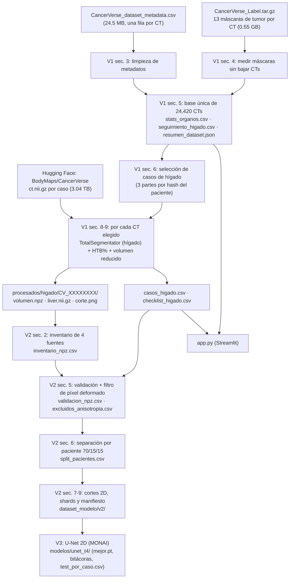

# Datos de CancerVerso: diccionario y linaje

Este documento dice **qué datos existen en el proyecto, de dónde sale cada uno, qué significa cada columna y qué controles pasó**. Es la referencia para entender las tablas del notebook, la app y el dataset con el que se entrena la U-Net.

Avance al 24 de noviembre de 2026 (03:45).

> Los datos **no se suben a GitHub** (licencia CC BY-NC-ND 4.0 del dataset y reportes radiológicos en las tablas). Viven en Google Drive, en `MyDrive/Big data Zucco/`, y una copia de las tablas de la app en `datos/` de la carpeta local.

---

## 1. Resumen en números

| Etapa | Qué es | Cuántos | Tamaño |
|---|---|---|---|
| Dataset original | CancerVerse en Hugging Face | 24,422 CTs · 14,599 pacientes | 3.04 TB |
| Medición de máscaras | CTs con máscaras de tumor medidas sin bajar el CT | 24,420 CTs · 12,529 anotaciones de tumor | 0.55 GB de máscaras |
| CTs de hígado procesados | CT completo + TotalSegmentator + HTB% | 2,336 CTs · 1,319 pacientes | 300.9 GB de CT leídos |
| Volúmenes reducidos | un `volumen.npz` por CT | 2,336 archivos | 6.0 GB |
| Dataset 2D para la U-Net (v2) | cortes con hígado, 256×256, etiqueta por píxel | 2,264 CTs · 1,291 pacientes · 180,238 cortes | 23.6 GB en 90 shards |
| U-Net entrenada | `mejor.pt` (6.5 M parámetros) | Dice de tumor en test 0.65 · HTB% r = 0.85 | 26 MB |

**Reducción de volumen:** cada CT pasa de ~129 MB a ~2.6 MB en su `volumen.npz` (unas 50 veces menos). El dataset 2D vuelve a crecer a 23.6 GB **a propósito**: se guarda sin comprimir para que el entrenamiento lea rápido (ver sección 6).

---

## 2. Linaje: de dónde sale cada cosa

| Notebook | Qué hace | Dónde corre |
|---|---|---|
| `notebooks/CancerVerso_V1.ipynb` | Secciones 1–13: metadatos, máscaras, selección, TotalSegmentator, HTB%, volúmenes reducidos, control de calidad y unión de las 3 partes | Colab (T4) de cada integrante |
| `notebooks/CancerVerso_V2_datos_modelo.ipynb` | Inventario, validación, separación por paciente, dataset 2D en shards y benchmark de lectura | Colab de Isay (CPU con RAM amplia) |
| `notebooks/CancerVerso_V3_unet.ipynb` | Benchmark de GPU, verificación MD5, entrenamiento de la U-Net y evaluación en test | Colab de Isay (G4; la primera corrida fue en T4: `CancerVerso_V3_unet_corrida_T4.ipynb`) |

**Reparto en 3 partes:** cada paciente cae en una parte según el hash MD5 de su ID, así que todos sus estudios quedan juntos. Parte 0: Isay (1,909 CTs) y Paloma (27 nuevos + 173 repetidos que sirvieron como prueba de reproducibilidad: diferencia máxima de HTB% de 0.01). Parte 1: Paul (200). Parte 2: Christopher (200).

---

## 3. Dónde vive cada archivo

En Drive, `MyDrive/Big data Zucco/`:

| Carpeta | Contenido |
|---|---|
| `raw/` | Metadatos y máscaras originales (`CancerVerse_dataset_metadata.csv`, `CancerVerse_Label.tar.gz`) y CTs de Isay |
| `procesados/higado/CV_XXXXXXXX/` | `volumen.npz`, `liver.nii.gz` (máscara de TotalSegmentator) y `corte.png` de cada CT de la parte de Isay |
| `companeros/` | Accesos directos a las carpetas `Big data Zucco` de Paul (`parte1_paul`), Christopher (`parte2_christopher`) y Paloma (`parte0_paloma`), con la misma estructura |
| `stats/` | Todas las tablas CSV de las secciones 4 y 5 de este documento |
| `dataset_modelo/v2/` | Shards del dataset 2D, `manifest.json` e `indice_cortes.csv` (versión vigente) |
| `dataset_modelo/v1/` | Primera corrida, sin el filtro de píxel deformado (obsoleta) |
| `modelos/unet_t4/` | U-Net entrenada en T4: `mejor.pt`, `ultimo.pt`, bitácoras, `test_por_caso.csv`, gráficas y `resumen.json` (sección 7) |
| `modelos/unet_g4/` | Igual, cuando se entrene en G4 |

En la carpeta local, `datos/stats/` tiene las tablas que lee la app (unión de las 3 partes) y `datos/procesados/` los volúmenes que muestra.

---

## 4. Diccionario de las tablas de la V1

### 4.1 Metadatos limpios (en memoria, sección 3 de la V1)

Se leen de `CancerVerse_dataset_metadata.csv` y se renombran:

| Columna | Original | Significado | Limpieza |
|---|---|---|---|
| `caso` | CancerVerse ID | ID del CT, `CV_XXXXXXXX` | — |
| `paciente` | Patient ID | ID anónimo del paciente (16 caracteres) | — |
| `estudio` | Encrypted Accession Number | ID del estudio (un estudio puede tener varias fases) | — |
| `sexo` | sex | `F` o `M` | Faltantes: primer sexo conocido del mismo paciente |
| `edad` | age | Años | "above 89" → 90; faltantes: promedio de sus otros estudios |
| `fase` | phase | Fase del contraste (portal venosa, arterial, etc.) | Faltante → `sin_dato` |
| `fecha` | exam_date | Fecha del estudio | Texto `MM-DD-YYYY` → fecha; 4,153 CTs sin fecha |
| `icd10` | icd10_code | Código de diagnóstico | — |
| `reporte` | report | Reporte radiológico en texto | **Dato sensible: por esto los CSV no van a GitHub** |

### 4.2 `stats_organos.csv` — una fila por órgano (13)

| Columna | Significado |
|---|---|
| `organo` / `nombre` | Clave en inglés (`liver`) y nombre en español (`Hígado`) |
| `n_casos` | CTs con máscaras (24,420) |
| `n_con_tumor`, `pct_con_tumor` | CTs con tumor de ese órgano y su porcentaje |
| `vol_tumoral_medio_cm3`, `vol_tumoral_mediana_cm3` | Volumen de tumor por CT, en cm³ |
| `n_pacientes_con_tumor` | Pacientes distintos con tumor de ese órgano |
| `pacientes_2mas_fechas` | Pacientes con tumor en 2 o más fechas |
| `edad_media`, `pct_mujeres` | Calculados **por paciente** (su primer estudio con tumor), no por CT |
| `n_partes` | Cuántas partes del reparto se sumaron |

### 4.3 `seguimiento_higado.csv` — una fila por paciente y fecha

| Columna | Significado |
|---|---|
| `paciente`, `fecha`, `caso`, `fase` | Estudio elegido para esa fecha (si hay varios CTs, el de mayor volumen) |
| `vol_cm3` | Volumen de tumor hepático medido en la máscara |
| `dias` | Días desde el primer estudio del paciente |
| `misma_fase` | `True` si todas sus fechas usan la misma fase |
| `salto_10x` | `True` si el volumen cambió más de 10 veces respecto al estudio anterior |
| `revisar` | `True` si hay salto de 10× o el tumor mide menos de 1 cm³ |
| `parte`, `n_partes` | Parte del reparto de donde viene |

Solo entran CTs con tumor hepático anotado y con fecha.

### 4.4 `checklist_higado.csv` — bitácora de proceso por CT

| Columna | Significado |
|---|---|
| `caso` | CT procesado |
| `estado` | `ok` o `error` (cuenta el último estado de cada caso) |
| `detalle` | Mensaje de error, si lo hubo |
| `gb_ct` | Tamaño del CT original en GB |
| `segundos` | Tiempo total del caso (bajar, segmentar, medir, guardar) |
| `procesado_el` | Fecha y hora |
| `parte`, `n_partes` | Parte del reparto |

### 4.5 `casos_higado.csv` — métricas por CT de hígado (2,336)

| Columna | Significado |
|---|---|
| `caso`, `paciente`, `fecha`, `sexo`, `edad`, `fase`, `icd10`, `reporte` | Datos del estudio (de 4.1) |
| `vol_tumor_cm3` | Volumen del tumor anotado |
| `vol_higado_cm3` | Volumen de hígado = TotalSegmentator ∪ tumor |
| `htb_pct` | **Carga tumoral hepática** = tumor ÷ hígado × 100 |
| `n_lesiones` | Zonas de tumor separadas entre sí |
| `voxeles_tumor_fuera_higado`, `pct_tumor_fuera_higado` | Tumor que quedó fuera de la máscara de TotalSegmentator (control de calidad) |
| `ts_rapido` | `True` si se segmentó en modo rápido (`--fast`, sin GPU): resultado provisional |
| `corte_max_tumor`, `n_cortes` | Corte con más tumor y número de cortes del volumen reducido |
| `dias` | Días desde el primer estudio del paciente |
| `parte`, `n_partes` | Parte del reparto |

**Todas las métricas se calculan sobre el CT completo**, antes de reducirlo.

### 4.6 `resumen_dataset.json`

Cifras de la portada: `n_cts` (24,420), `n_cts_dataset` (24,422), `casos_sin_mascara` (2), `n_cts_sin_fecha` (4,153), `n_pacientes` (14,597), `n_estudios`, `n_organos`, `n_anotaciones_tumor`, `n_cts_con_tumor`, `seguimiento_max_anios`, `n_partes`, `partes_incluidas` y `union_completa`.

### 4.7 `volumen.npz` — volumen reducido de un CT

| Clave | Tipo y forma | Significado |
|---|---|---|
| `ct` | `uint8` [cortes, alto, ancho] | CT en escala 0–255 con ventana de tejido blando **−160 a 240 HU** |
| `tumor` | `bool` [igual] | Máscara del tumor anotado por expertos |
| `higado` | `bool` [igual] | Hígado = TotalSegmentator ∪ tumor |
| `higado_ts` | `bool` [igual] | Hígado de TotalSegmentator solo (para control de calidad) |
| `espaciado_mm` | `float32` [3] | Milímetros por [corte, fila, columna] |

Cómo se construye: se recorta en z a la zona del hígado con 15 mm de margen, se aplica la ventana HU, se reduce a 256 px en el lado mayor y a máximo 96 cortes, y se reordena a vista axial radiológica. Las máscaras se interpolan y se cortan en 0.3 (no en 0.5) para no perder lesiones pequeñas.

---

## 5. Diccionario de las tablas de la V2 (`stats/`)

| Archivo | Una fila por | Columnas |
|---|---|---|
| `inventario_npz.csv` | CT único con `volumen.npz` | `caso`, `fuente` (isay, parte0_paloma, parte1_paul, parte2_christopher), `ruta` en Drive, `mb` |
| `inventario_faltantes.csv` | Caso `ok` en un checklist cuyo archivo no está | `caso`, `fuente` (hoy vacío: no falta ninguno) |
| `validacion_npz.csv` | CT revisado | `estado`, `detalle`, `cortes`, `alto`, `ancho`, `cortes_con_higado`, `tumor_fuera_higado_px`, `htb_npz` (HTB% del volumen reducido), `htb_pct` (original), `dif_htb`, `mm_fila`, `mm_columna`, `ratio_pixel` |
| `excluidos_anisotropia.csv` | CT excluido del dataset 2D | `caso`, `fuente`, `paciente`, `alto`, `ancho`, `mm_fila`, `mm_columna`, `ratio_pixel`, `htb_pct` |
| `split_pacientes.csv` | CT del dataset 2D | `caso`, `paciente`, `split` (train/val/test), `fuente` |
| `indice_cortes.csv` | Corte 2D | `split`, `shard`, `fila` (posición dentro del shard), `caso`, `paciente`, `corte_original`, `px_higado`, `px_tumor`, `tiene_tumor` |
| `balance_clases.csv` | Grupo (train/val/test) | `cortes`, `cortes_con_tumor`, `px_fondo`, `px_higado`, `px_tumor` y sus porcentajes |
| `benchmark_lectura.csv` | Prueba de lectura | `prueba`, `cortes`, `segundos`, `mb`, `cortes_por_s`, `veces_vs_drive_sueltos` |
| `bitacora_paso3.csv` | Etapa del notebook V2 | `etapa`, `segundos`, `detalle` |

---

## 6. El dataset 2D para la U-Net (`dataset_modelo/v2/`)

### Contenido

| Archivo | Qué es |
|---|---|
| `train/shard_000.npz` … | ~2,000 cortes por archivo. Clave `img`: `uint8` [N, 256, 256], CT 0–255. Clave `lbl`: `uint8` [N, 256, 256], 0 = fondo, 1 = hígado sin tumor, 2 = tumor |
| `val/`, `test/` | Igual, para validación y prueba |
| `indice_cortes.csv` | De qué caso, paciente y corte viene cada fila de cada shard |
| `manifest.json` | Linaje: origen, ventana HU, formato, semilla, criterios de exclusión, conteos por grupo y **huella MD5 de cada shard** |

### Cifras

| Grupo | Pacientes | CTs | Cortes | Cortes con tumor | Píxeles de tumor |
|---|---|---|---|---|---|
| train | 904 | 1,582 | 126,199 | 48.4% | 0.64% |
| val | 194 | 336 | 26,671 | 52.8% | 0.68% |
| test | 193 | 346 | 27,368 | 44.9% | 0.52% |
| **Total** | **1,291** | **2,264** | **180,238** | | |

### Decisiones y por qué

| Decisión | Por qué |
|---|---|
| Separar por **paciente**, no por CT (semilla 42) | Si un paciente quedara en train y en test, el modelo "ya lo habría visto" y el Dice saldría inflado |
| Solo cortes con hígado | Los cortes sin hígado no aportan a esta tarea y harían el dataset más grande |
| Tamaño fijo 256×256, relleno con ceros centrado | La red necesita entradas del mismo tamaño; 2,218 volúmenes ya medían 256×256 |
| CT en `uint8`, normalización a 0–1 al cargar (÷255) | `float32` ocuparía 4 veces más disco y RAM sin ganar información |
| Shards sin comprimir (`np.savez`) | Descomprimir se pagaría en cada época; leer un shard sin comprimir es casi gratis |
| No se tiran cortes sin tumor | El modelo también debe aprender a decir "aquí no hay tumor" |
| Pérdida Dice + entropía cruzada en el paso 4 | El tumor es menos del 1% de los píxeles; un modelo que nunca pinte tumor tendría 99% de exactitud y no serviría |

### Por qué los shards: benchmark de lectura

Cuántos cortes con hígado por segundo llegan al modelo según cómo se lean (CPU con RAM amplia, 24 nov):

| Forma de leer | Corrida 1 | Corrida 2 |
|---|---|---|
| 100 `volumen.npz` sueltos desde Drive, 1 hilo | 77 | 85 |
| Los mismos, desde el disco local de Colab | 1,290 | 1,314 |
| 2 shards desde Drive* | 1,230 | 1,667 |
| 2 shards desde el disco local | 1,813 | 4,184 |
| Cortes ya en RAM (solo normalizar) | 8,557 | 5,874 |

\* Los shards se acababan de escribir y Colab pudo tenerlos en caché, así que esta cifra puede salir optimista.

Lo estable entre corridas: leer archivo por archivo desde Drive da **~80 cortes/s**, y cualquier otra forma pasa de **1,300** (15 a 70 veces más). Las pruebas cortas (shards locales, RAM) varían entre corridas. Por eso se copia todo al disco local con 16 hilos (6 GB en ~85–100 s, ~60–70 MB/s) y la U-Net carga los shards en RAM.

---

## 7. El modelo (notebook V3, `modelos/unet_<gpu>/`)

### Archivos

| Archivo | Qué es |
|---|---|
| `mejor.pt` | Pesos de la época con mejor Dice de tumor en validación (26 MB) |
| `ultimo.pt` | Pesos + optimizador + época, para seguir entrenando (78 MB) |
| `bitacora_entrenamiento.csv` | Una fila por época: `epoca`, `perdida_train`, `dice_val_higado`, `dice_val_tumor`, `lr`, `segundos_train`, `cortes_por_s`, `gpu`, `lote`, `memoria_gpu_gb` |
| `test_por_caso.csv` | Una fila por CT de test: píxeles predichos, reales y en común de hígado y tumor; `dice_higado`, `dice_tumor`, `htb_real`, `htb_pred`, `error_htb` |
| `resumen.json` | Modelo, dataset, GPU, precisión, lote, épocas y métricas de test |
| `bitacora_tiempos.csv` | Tiempo de cada etapa del notebook |
| `curvas_entrenamiento.png`, `evaluacion_test.png`, `ejemplos_test.png` | Gráficas |
| `stats/benchmark_gpu.csv` | Cortes por segundo por GPU, precisión y lote (una fila por medición) |

### Receta

MONAI `UNet` 2D, canales (32, 64, 128, 256, 512), 2 unidades residuales (6.5 millones de parámetros); entrada 1 canal (CT 0–1), salida 3 clases (fondo, hígado, tumor). Pérdida Dice + entropía cruzada; AdamW con tasa 1e-3 que baja en coseno; precisión mixta (bf16 en GPUs con capacidad ≥ 8, fp16 en la T4). Se elige la época con mejor Dice de tumor en validación.

### Resultados (T4, 24 nov 2026)

14 épocas en 2 h 5 min (tope de 120 min). Mejor época: 4 (Dice de tumor en validación 0.751).

| Métrica en test (346 CTs, 193 pacientes nunca vistos) | Valor |
|---|---|
| Dice de hígado, global / mediana por CT | 0.949 / 0.969 |
| Dice de tumor, global / mediana por CT | 0.653 / 0.521 |
| Dice de tumor por tamaño (cuartiles de píxeles de tumor) | chico 0.13 · medio-chico 0.52 · medio-grande 0.64 · grande 0.74 |
| HTB% predicho vs real: correlación | 0.85 |
| HTB% predicho vs real: error absoluto mediano / medio | 0.66 / 2.67 puntos |

**Cómo leerlo:** el hígado se segmenta casi perfecto. El tumor depende del tamaño: las lesiones chicas son las difíciles. El HTB% sale bien en la mayoría de los CTs, pero los 14 casos con HTB real arriba de 40% quedan subestimados.

**Límites:** (1) la validación se usó para elegir la mejor época; (2) solo se evalúan cortes que tienen hígado según la máscara de referencia, y un caso real tendría que revisar el CT completo. Las cifras de test son, por eso, algo optimistas.

---

## 8. Controles de calidad

| Control | Dónde | Resultado |
|---|---|---|
| CT y máscaras con el mismo tamaño y la misma posición (affine) | V1 sec. 8 | Si no coinciden, el caso falla y se registra |
| Truco de máscaras vacías verificado en 1 de cada 1,500 | V1 sec. 4 | Ver salida de la sección 4 (`saltadas_con_tumor`) |
| Reproducibilidad entre integrantes | 173 casos que corrieron Isay y Paloma | Diferencia máxima de HTB% de 0.01 |
| Errores de proceso | `checklist_higado.csv` | 9 errores, todos recuperados en la siguiente corrida |
| Tumor fuera de la máscara de TotalSegmentator | V1 sec. 10 | 445 de 2,336 CTs con más de 10% fuera: revisar su HTB% |
| Inventario: checklist vs archivos en Drive | V2 sec. 2 | 2,336 de 2,336, 0 faltantes |
| Cada `volumen.npz` abre, trae sus 5 claves, tipos y tamaños | V2 sec. 5 | 0 errores |
| Tumor dentro del hígado en el volumen reducido | V2 sec. 5 | 0 casos fuera |
| HTB% del volumen reducido vs original | V2 sec. 5 | Mediana 0.07 puntos, máximo 1.53 |
| **Píxel deformado** (`ratio_pixel` > 1.5) | V2 sec. 5 | **72 CTs excluidos** del dataset 2D |
| Ningún paciente en dos grupos | V2 sec. 6 | Comprobado con `assert` |
| Integridad de los shards | `manifest.json` | Huella MD5 de cada archivo |
| Shards antes de entrenar = shards documentados | V3 sec. 3 | 90 de 90 huellas coinciden |
| Separación por paciente en los cortes que entran a la red | `indice_cortes.csv` | 0 pacientes y 0 CTs en dos grupos; 0 cortes repetidos |

### El caso del píxel deformado

Algunas series se adquirieron en otro plano con cortes gruesos. Al verlas en vista axial, cada píxel mide, por ejemplo, **10.4 mm de alto y 1.3 mm de ancho** (`CV_00001181`, que queda de 22×256 px), y la imagen sale aplastada. Si la U-Net entrenara con ellas, aprendería un hígado deformado.

- **Criterio:** `ratio_pixel = max(mm_fila, mm_columna) ÷ min(mm_fila, mm_columna)`; si es mayor que 1.5, el CT sale del dataset 2D.
- **Resultado:** 72 CTs (65 pacientes): 60 de la parte de Isay, 6 de Paul y 6 de Christopher. Sus ratios van de 2.0 a 7.9; **ningún caso cae entre 1.5 y 2**, así que el umbral separa limpio.
- **Qué no cambia:** su HTB% sigue siendo válido para la app, porque se midió sobre el CT completo. Solo no se usan para entrenar.
- Los otros 46 volúmenes que no miden 256×256 tienen píxel cuadrado (su matriz original es rectangular) y se quedan.

---

## 9. Cómo reproducirlo

1. Correr `CancerVerso_V1.ipynb` en Colab con GPU (cada integrante su parte; la sección 13 junta las partes).
2. Crear en Drive los accesos directos de `companeros/` (instrucciones al inicio del notebook V2).
3. Correr `CancerVerso_V2_datos_modelo.ipynb` con **Ejecutar todo** (CPU con RAM amplia basta; ~20 min).
4. Correr `CancerVerso_V3_unet.ipynb` con GPU (de preferencia G4) y **Ejecutar todo**: verifica las huellas MD5, entrena y evalúa. Para solo medir una GPU, correr las secciones 1 y 2.

Con la misma semilla (42) sale la misma separación y los mismos shards.
